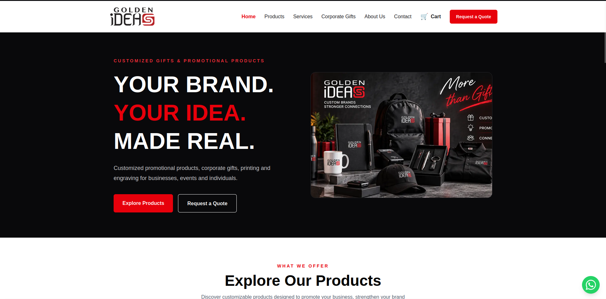
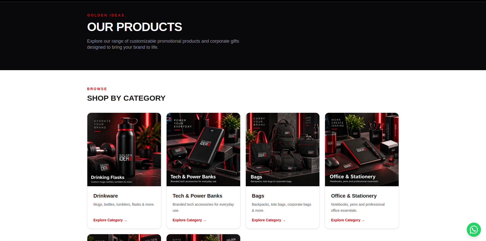
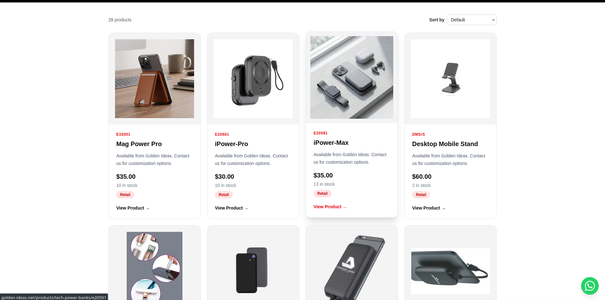
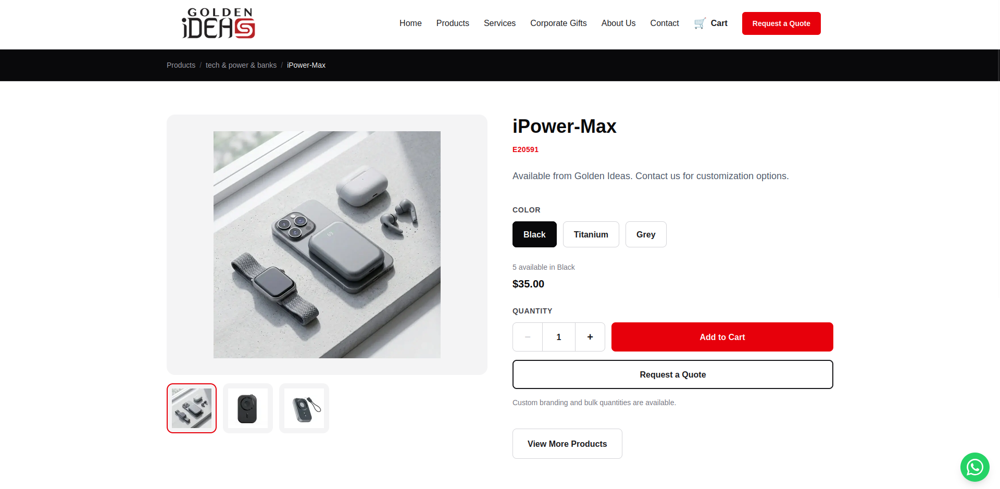
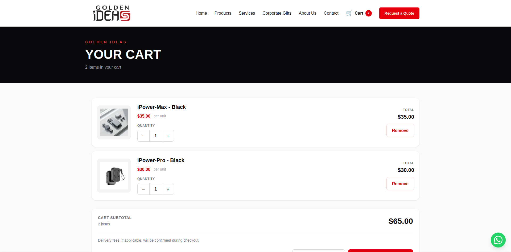

# Golden Ideas — E-commerce Website

A custom e-commerce website built for Golden Ideas, a gift and promotional products business in Lebanon.

**[Visit the live website →](https://golden-ideas.net/)**

## About the Project

The website gives customers a convenient way to explore products, browse categories, add items to their cart, and place cash-on-delivery orders. It also provides a way to request quotes for bulk and corporate purchases.

This project was taken from initial development through testing and live deployment.

## Features

- Responsive layouts for desktop and mobile
- Product categories and individual product pages
- Product image galleries
- Shopping cart with quantity controls
- Checkout with customer and delivery details
- Cash-on-delivery ordering
- Bulk and corporate quote requests
- WhatsApp contact button

## Technology Stack

- **Frontend:** Next.js, React, TypeScript, Tailwind CSS
- **Database:** PostgreSQL hosted on Neon
- **Database ORM:** Prisma
- **Deployment:** Vercel

## My Role

I built and deployed the website, including the user interface, product browsing experience, cart, checkout, and database integration. I used AI-assisted development tools throughout the process and handled implementation, testing, and launch.

## Screenshots

### Homepage

### Product Categories

### Product Catalog

### Product Details

### Shopping Cart

## Source Code

This repository showcases the completed project. The production source code is maintained privately.
